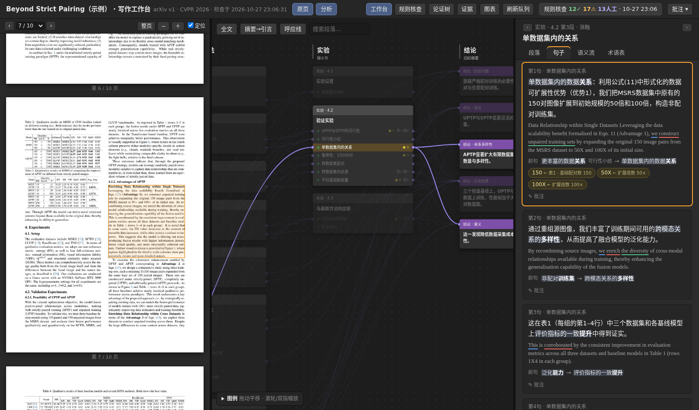
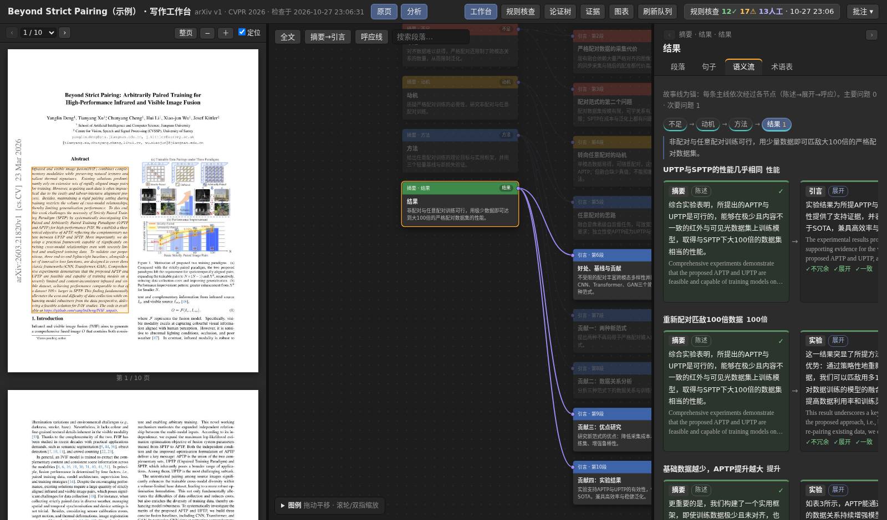
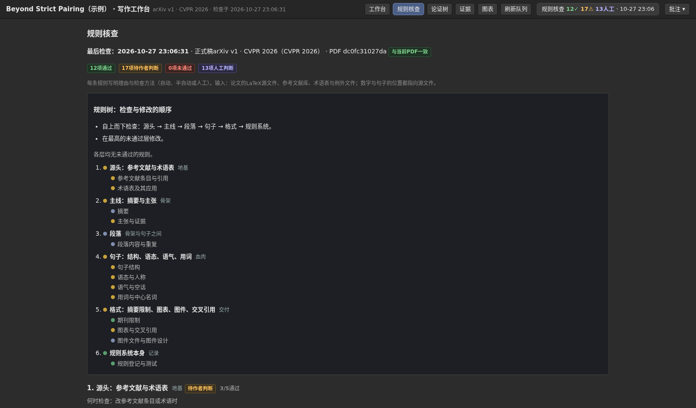

# The workbench

**English** · [简体中文](workbench.zh-CN.md)

`paperrules workbench` builds one self-contained HTML page for a paper: the PDF pages, an argument canvas, and the analysis panels
side by side, plus six views (rules, argument tree, evidence, figures and tables, refresh queue). It is the reading surface of the
writing workflow that paperrules came out of: you read a sentence, see where it sits in the argument, what it links to, which
number it rests on and which rules it breaks, and you write your notes next to it.

<p align="center"></p>

The page shows the **example paper** (a CC BY 4.0 CVPR 2026 paper) with annotations written for this repository.
Open [`examples/aptp-cvpr2026/expected/workbench.html`](../examples/aptp-cvpr2026/expected/workbench.html) in a browser (download it first;
GitHub shows HTML as text), or build it yourself:

```bash
pip install -e ".[workbench]"                      # adds PyMuPDF for the PDF pane
python -m paperrules workbench examples/aptp-cvpr2026
# open examples/aptp-cvpr2026/out/workbench.html
```

> **Treat the page like the manuscript.** It embeds the whole text of the paper and your notes in one file. Do not publish the page
> of an unpublished paper. The interface is in Chinese; the paper text is whatever language the paper is in.

## The panels

| Where | Panel | What it shows |
|---|---|---|
| left | **PDF pages** | The compiled PDF; a click on a paragraph selects it everywhere, and selecting elsewhere scrolls the PDF to it. The rectangles come from aligning the LaTeX text with the PDF text lines. |
| middle | **Argument canvas** | A node editor: abstract slots → introduction paragraphs → body sections → conclusion claims. Wires are claims that a paragraph serves; yellow fields are numbers, and a click on one lights every place the same number appears. Tab and the arrow keys move between nodes. |
| right | **Paragraph** | The paragraph's question, claim and outline steps, matched to its sentences; where it sits in the argument; figures, tables and citations it first cites. |
| right | **Sentences** | Each sentence in the rendering you annotate (Chinese in the example) with the original beneath; subject, predicate and object underlined; the phrase that links it to the previous sentence or to earlier text, with its head noun in bold; the numbers it uses with their sources; a note box. |
| right | **Semantic flow** | The storyline view: one claim followed through the levels (abstract → introduction → body → conclusion) as cards, each with four checks (expands, not a copy, key concepts kept, echoes). |
| right | **Glossary** | The project glossary, with the terms the selected paragraph uses on top. |
| header | **Rules** | The rule tree and every rule with its findings (the same result as `paperrules check`). |
| header | **Argument tree** | Abstract slots with their sub-claims, the conclusion claims and what supports them, and the paragraph tree. |
| header | **Evidence** | Every recorded number with its source (a table cell of the paper, or a formula over other records) and every sentence that uses it. |
| header | **Figures and tables** | The paper's own tables (read from the LaTeX, best values in bold) and figures, each with the paragraph that first cites it. |
| header | **Refresh queue** | The sentences and paragraphs that changed since the author last accepted the page (`--accept`). |

<p align="center"> </p>

Notes are kept in the browser (`localStorage`) per sentence, paragraph, storyline and view; **Notes ▾** exports, imports, copies and
summarises them. A note can be copied together with the analysis it is about, to paste into a message or into an assistant.

## What comes from where

| Layer | Source | Without it |
|---|---|---|
| sentences, paragraphs, sections, figures, tables, citations | the LaTeX reader (automatic) | – |
| rule findings, rule tree | `paperrules check` (automatic) | – |
| subject / predicate / object marks of the English sentence | spaCy (automatic) | – |
| PDF pages and paragraph rectangles | the `pdf` file and PyMuPDF (automatic) | the PDF pane is hidden |
| tables of the paper | parsed from the `tabular` (automatic; plain tables only) | caption only |
| glossary | `glossary.json` | the glossary panel is empty |
| rendering of each sentence, sentence links, paragraph claims, abstract slots, conclusion claims, storyline, evidence records | **the annotation file** `workbench.json` | the original sentence is shown in place of the rendering; the other panels say what is missing |
| refresh queue | the accepted baseline `workbench.baseline.json` | empty |

The annotation file is text that you write, or have an assistant write from the paper and then check. **The semantic flow and the
argument canvas are only as good as the annotations.**

## Commands

```bash
python -m paperrules workbench <project>                  # build → <project>/out/workbench.html
python -m paperrules workbench <project> --ids            # every paragraph and sentence id with its text, to write the annotations
python -m paperrules workbench <project> --skeleton       # a workbench.json with every id and empty fields
python -m paperrules workbench <project> --check          # the annotations against the paper: ids, quotes, evidence literals
python -m paperrules workbench <project> --accept "v2"    # after reading the refresh queue: this state is the new baseline
python -m paperrules workbench <project> --out page.html  # another output file
```

Project settings, in `paperrules.json`:

```json
{"workbench": {"annotations": "workbench.json", "pdf": "paper/paper.pdf", "output": "out/workbench.html", "baseline": "workbench.baseline.json"}}
```

`pdf` is the compiled paper (build it yourself; paperrules does not compile). Reduce its size with
`doc.rewrite_images(dpi_threshold=150, dpi_target=110, quality=60)` in PyMuPDF if it is large: the page embeds an image of every page.

## The annotation file

Every field is optional. Ids come from `--ids`: paragraphs `P001…`, sentences `P013-R002` (paragraph and index).

```jsonc
{
  "title": "…", "version": "…", "journal": "…",
  "chapters": {"Introduction": "引言"},               // how a chapter is named in the page
  "sections": {"Loss Functions": "损失函数"},
  "abstract": {"slots": [                              // the argument of the abstract: one slot per move
    {"id": "S1", "name": "State of the art", "name_zh": "研究现状", "claim_zh": "…", "claim_en": "…", "scope": "…",
     "sentences": ["P001-R001"], "points": [{"id": "S1.a", "zh": "sub-claim"}]}]},
  "paragraphs": {"P013": {                             // what each paragraph does
    "title": "…", "question": "…", "claim": "…", "flow": "step → step → step", "scope": "…",
    "move": "background",                              // background, problem, motivation, approach, analysis, setup, main_results, ablation …
    "serves": ["S1.a", "C2"]}},                        // sub-claims and conclusion claims it supports: these are the wires of the canvas
  "rows": {"P013-R002": {                              // the rendering of a sentence and its links
    "zh": "…",
    "previous": {"anchor_id": "P013-R001", "anchor_quote": "phrase in the previous rendering", "anchor_head": "head noun",
                 "target_quote": "phrase in this rendering", "target_head": "head noun", "relation": "…", "phrase_type": "名词短语"},
    "earlier": {"…": "same keys; a link to text before the previous sentence"}}},
  "claims": [{"id": "C1", "short": "…", "zh": "…", "sentences": ["P041-R001"], "mirrors": ["S2.a"], "supported_by": ["P003"]}],
  "storyline": [{"id": "GAP", "name": "不足", "story": "…", "points": [
    {"key": "S2.a", "zh": "…", "concepts": [{"zh": "term", "core": true}],
     "nodes": [{"level": "摘要", "role": "state", "rows": ["P001-R003"]}, {"level": "引言", "role": "expand", "rows": ["P003-R003"]},
               {"level": "结论", "role": "echo", "rows": ["P041-R005"]}]}]}],
  "evidence": {"records": {"table1.base.150": {"label": "…", "printed": "150", "type": "table", "file": "sec/3_method.tex", "row": {"mode": "SPTP"},
                                                "column": "Quantity", "floats": ["tab:feasibility"]}},
               "sentences": {"P032-R002": {"evidence": [{"literal": "150", "record": "table1.base.150"}], "unresolved": []}}}
}
```

`--check` verifies the parts that can be verified: ids exist; each `anchor_quote` is in the rendering of its anchor sentence and each
`target_quote` in the rendering of its own; each head is inside its quote; each evidence `literal` is in its sentence.
It cannot verify that a translation is right or that a claim is a fair summary. For the example, all of this was written for this
repository by an assistant working from the paper, and it may contain errors.

The storyline checks are word-overlap heuristics (they flag, you judge): an *expand* node must add at least three words the previous node
lacks; a node must not be a near copy of the previous one (similarity ≥ 0.75 flags, ≥ 0.9 is major); every *core* concept of the point must come
back in an expanding node; an *echo* node must repeat at least one core concept.

## For people who change the page

The page is `paperrules/workbench/template/` (`main_template.html`, `main.js`, `ws_views.js`; no framework, no network) filled by
`page.py`. All data is one object `D`, built by `model.py`. The keys the page reads:

| key | content |
|---|---|
| `ids` | `abstract` and `conclusion` paragraph ids, `slots`, `slot2line`, `trace_labels` |
| `paragraphs`, `rows` | the text, with `areas` (page and rectangle) per paragraph and `cn_analysis` per row |
| `source_units`, `page_dimensions` | what the PDF pane needs |
| `terms` | glossary, with the rows that use each term |
| `canvas`, `step_map` | the node editor and the outline matching |
| `flow` | the storyline view |
| `ws` | argument tree, evidence records, floats, queue (`slots`, `conclusion`, `nodes`, `paragraphs`, `sentences`, `records`, `floats`, `queue` …) |
| `compliance` | the rule report in the shape of the Rules view |
| `spo` | subject, predicate and object spans per row |

Nothing in the template names a paper: a test (`tests/test_workbench.py`) fails if a paper-specific id comes back.

## Limits

* The interface text is Chinese. The analysis is written for a second rendering of each sentence; with no annotations it shows the
  original sentence twice.
* The PDF alignment is heuristic: in the example 50 of 53 paragraphs are placed (not placed: mostly heavy mathematics).
* Subject, predicate and object marks are for the English sentence only; the rendering needs its own parse.
* Tables are read from simple `tabular` environments; merged cells and unusual macros may flatten.
* The page does not compile the paper and does not track references to other files.
