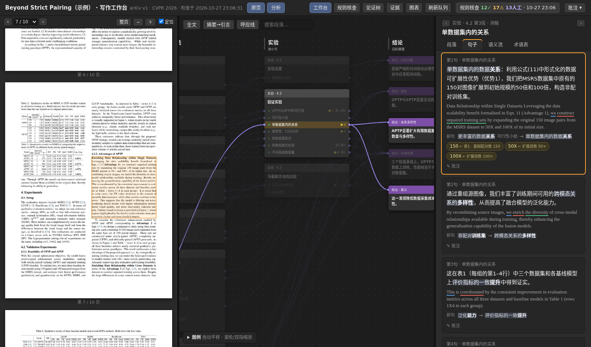
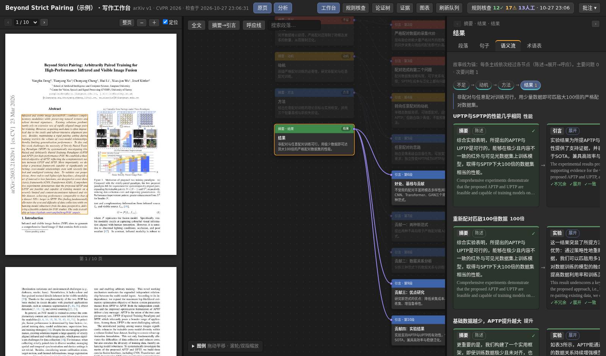
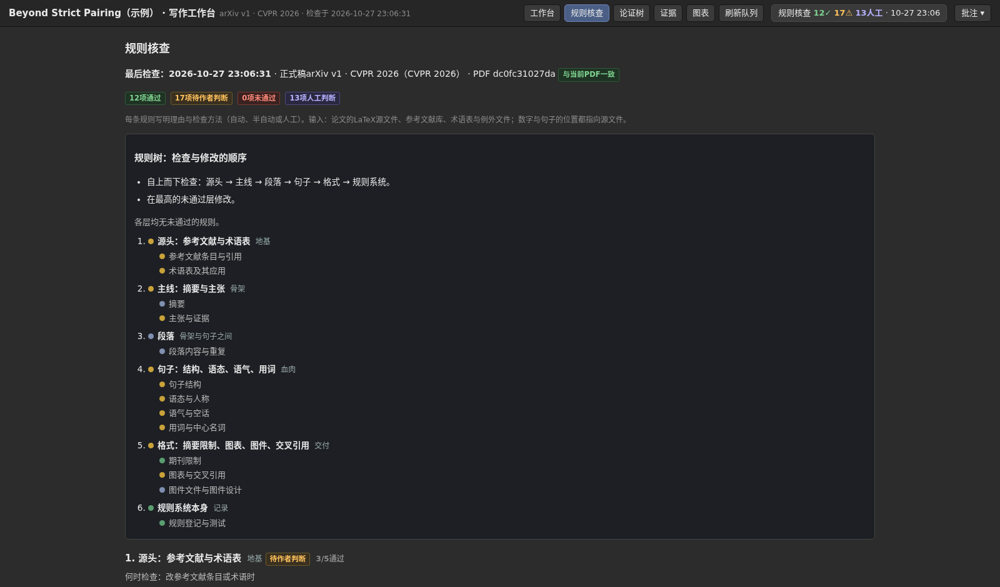

# 工作台

[English](workbench.md) · **简体中文**

`paperrules workbench` 为一篇论文生成一个自包含的 HTML 页面：PDF 页面、论证画布和各分析面板并排，另有六个视图（规则核查、论证树、证据、图表、刷新队列）。
它是 paperrules 所源自的写作流程的阅读界面：读一句话，就能看到它在论证中的位置、与什么相连、依据哪个数字、违反了哪些规则，并把批注写在旁边。

<p align="center"></p>

页面展示的是**示例论文**（一篇 CC BY 4.0 的 CVPR 2026 论文），标注是为本仓库写的。
可下载 [`examples/aptp-cvpr2026/expected/workbench.html`](../examples/aptp-cvpr2026/expected/workbench.html) 后用浏览器打开（GitHub 会把 HTML 当文本显示），或自己生成：

```bash
pip install -e ".[workbench]"                      # 加装 PyMuPDF，用于 PDF 面板
python -m paperrules workbench examples/aptp-cvpr2026
# 打开 examples/aptp-cvpr2026/out/workbench.html
```

> **把这个页面当作稿件对待。** 它把论文全文与你的批注嵌在一个文件里。未发表论文的页面不要公开发布。
> 界面文字是中文；论文正文是论文本身的语言。

## 各面板

| 位置 | 面板 | 内容 |
|---|---|---|
| 左 | **PDF 原页** | 编译好的 PDF；点击一段会在各处同时选中它，在别处选中时 PDF 会滚到该段。矩形来自 LaTeX 文本与 PDF 文本行的对齐。 |
| 中 | **论证画布** | 节点编辑器：摘要论证槽 → 引言各段 → 正文各节 → 结论主张。连线是段落所服务的主张；黄色字段是数字，点一个数字，全文中同一数字出现的位置都会亮起。Tab 与方向键在节点间移动。 |
| 右 | **段落** | 本段的问题、判断与写作步骤，并与句子对应；本段在论证中的位置；本段首次引用的图、表与文献。 |
| 右 | **句子** | 每句的标注语言（示例为中文）及其下的原文；主语、谓语、宾语加下划线；与前句或前文相连的短语（中心名词加粗）；句中数字及其来源；批注框。 |
| 右 | **语义流** | 故事线视图：一条主张依次经过各层（摘要 → 引言 → 正文 → 结论）的卡片，每张卡片有四项检查（展开、不照搬、核心概念延续、呼应）。 |
| 右 | **术语表** | 项目术语表，本段用到的术语排在前面。 |
| 页头 | **规则核查** | 规则树与每条规则及其结果（与 `paperrules check` 相同）。 |
| 页头 | **论证树** | 摘要论证槽及其子主张、结论主张及其支撑、段落树。 |
| 页头 | **证据** | 每个登记的数字及其来源（论文自己的表格单元格，或由其他记录算出的公式）和用到它的每个句子。 |
| 页头 | **图表** | 论文自己的表格（读自 LaTeX，最佳值加粗）与图，并标出首次引用它们的段落。 |
| 页头 | **刷新队列** | 自作者上次确认（`--accept`）以来改变的句子与段落。 |

<p align="center"> </p>

批注保存在浏览器里（`localStorage`），按句子、段落、故事线与视图分别保存；**批注 ▾** 可导出、导入、复制与汇总。一条批注可连同它所针对的分析一起复制，贴到消息或助手里。

## 数据从哪里来

| 层 | 来源 | 没有时 |
|---|---|---|
| 句子、段落、章节、图、表、引用 | LaTeX 读取器（自动） | – |
| 规则结果、规则树 | `paperrules check`（自动） | – |
| 英文句子的主谓宾标记 | spaCy（自动） | – |
| PDF 页面与段落矩形 | `pdf` 文件与 PyMuPDF（自动） | 隐藏 PDF 面板 |
| 论文中的表格 | 从 `tabular` 解析（自动；仅限普通表格） | 只显示图注 |
| 术语表 | `glossary.json` | 术语表面板为空 |
| 每句的标注语言、句间链接、段落判断、摘要论证槽、结论主张、故事线、证据记录 | **标注文件** `workbench.json` | 用原句代替；其他面板会说明缺什么 |
| 刷新队列 | 已确认的基线 `workbench.baseline.json` | 为空 |

标注文件是你自己写的文字，或由助手依据论文写出后再由你核对。**语义流与论证画布的质量取决于标注。**

## 命令

```bash
python -m paperrules workbench <项目>                  # 生成 <项目>/out/workbench.html
python -m paperrules workbench <项目> --ids            # 打印每个段落与句子的编号及原文，供撰写标注
python -m paperrules workbench <项目> --skeleton       # 生成含全部编号和空字段的 workbench.json
python -m paperrules workbench <项目> --check          # 核对标注与论文：编号、引文、证据中的数字
python -m paperrules workbench <项目> --accept "v2"    # 读完刷新队列后，把当前状态设为新基线
python -m paperrules workbench <项目> --out page.html  # 写到别的文件
```

项目设置写在 `paperrules.json` 中：

```json
{"workbench": {"annotations": "workbench.json", "pdf": "paper/paper.pdf", "output": "out/workbench.html", "baseline": "workbench.baseline.json"}}
```

`pdf` 是编译好的论文（自己编译；paperrules 不负责编译）。页面会嵌入每一页的图片，PDF 太大时可用 PyMuPDF 的
`doc.rewrite_images(dpi_threshold=150, dpi_target=110, quality=60)` 缩小。

## 标注文件

所有字段都是可选的。编号来自 `--ids`：段落 `P001…`，句子 `P013-R002`（段落与序号）。

```jsonc
{
  "title": "…", "version": "…", "journal": "…",
  "chapters": {"Introduction": "引言"},               // 章名在页面中的叫法
  "sections": {"Loss Functions": "损失函数"},
  "abstract": {"slots": [                              // 摘要的论证：每个动作一个槽
    {"id": "S1", "name": "State of the art", "name_zh": "研究现状", "claim_zh": "…", "claim_en": "…", "scope": "…",
     "sentences": ["P001-R001"], "points": [{"id": "S1.a", "zh": "子主张"}]}]},
  "paragraphs": {"P013": {                             // 每段做什么
    "title": "…", "question": "…", "claim": "…", "flow": "步骤 → 步骤 → 步骤", "scope": "…",
    "move": "background",                              // background、problem、motivation、approach、analysis、setup、main_results、ablation …
    "serves": ["S1.a", "C2"]}},                        // 本段支撑的子主张与结论主张：这就是画布上的连线
  "rows": {"P013-R002": {                              // 一句的标注语言与链接
    "zh": "…",
    "previous": {"anchor_id": "P013-R001", "anchor_quote": "前一句标注中的短语", "anchor_head": "中心名词",
                 "target_quote": "本句标注中的短语", "target_head": "中心名词", "relation": "…", "phrase_type": "名词短语"},
    "earlier": {"…": "键相同；链接到前一句之前的文字"}}},
  "claims": [{"id": "C1", "short": "…", "zh": "…", "sentences": ["P041-R001"], "mirrors": ["S2.a"], "supported_by": ["P003"]}],
  "storyline": [{"id": "GAP", "name": "不足", "story": "…", "points": [
    {"key": "S2.a", "zh": "…", "concepts": [{"zh": "术语", "core": true}],
     "nodes": [{"level": "摘要", "role": "state", "rows": ["P001-R003"]}, {"level": "引言", "role": "expand", "rows": ["P003-R003"]},
               {"level": "结论", "role": "echo", "rows": ["P041-R005"]}]}]}],
  "evidence": {"records": {"table1.base.150": {"label": "…", "printed": "150", "type": "table", "file": "sec/3_method.tex", "row": {"mode": "SPTP"},
                                                "column": "Quantity", "floats": ["tab:feasibility"]}},
               "sentences": {"P032-R002": {"evidence": [{"literal": "150", "record": "table1.base.150"}], "unresolved": []}}}
}
```

`--check` 核对能核对的部分：编号存在；每个 `anchor_quote` 在其锚点句的标注中，每个 `target_quote` 在本句的标注中；中心名词在引文之内；证据中的 `literal` 在句子里。
它无法判断译文是否准确，也无法判断一条判断是不是公允的概括。示例中的这些内容由助手依据论文为本仓库写出，可能有错。

故事线的检查是词重合的启发式（只标出，由你判断）：*展开*节点至少要比上一节点多三个词；节点不能与上一节点近乎相同（相似度 ≥ 0.75 标出，≥ 0.9 为主要）；该子主张的每个*核心*概念要在展开节点中延续；*呼应*节点至少重复一个核心概念。

## 给要改页面的人

页面是 `paperrules/workbench/template/`（`main_template.html`、`main.js`、`ws_views.js`；无框架、无网络），由 `page.py` 填充。所有数据是一个对象 `D`，由 `model.py` 生成。页面读取的键：

| 键 | 内容 |
|---|---|
| `ids` | 摘要与结论段的编号、`slots`、`slot2line`、`trace_labels` |
| `paragraphs`、`rows` | 文本；每段的 `areas`（页码与矩形）与每句的 `cn_analysis` |
| `source_units`、`page_dimensions` | PDF 面板所需 |
| `terms` | 术语表及用到每个术语的句子 |
| `canvas`、`step_map` | 节点编辑器与步骤对应 |
| `flow` | 故事线视图 |
| `ws` | 论证树、证据记录、图表、队列（`slots`、`conclusion`、`nodes`、`paragraphs`、`sentences`、`records`、`floats`、`queue` …） |
| `compliance` | 规则核查视图所用形式的规则报告 |
| `spo` | 每句的主谓宾区间 |

模板里没有任何论文专用的名称：若专用编号再次出现，`tests/test_workbench.py` 会失败。

## 局限

* 界面文字是中文。分析面向每句的第二种表述；没有标注时，同一句原文会显示两遍。
* PDF 对齐是启发式的：示例中 53 段里放置了 50 段（未放置的多为公式密集的段）。
* 主谓宾标记只针对英文句子；标注语言需要自己的句法分析。
* 表格读自简单的 `tabular` 环境；合并单元格与特殊宏可能被压平。
* 页面不编译论文，也不跟踪对其他文件的引用。
